<picture>
  <source media="(prefers-color-scheme: dark)" srcset="assets/banner-dark.svg"/>
  
</picture>

 

Análise de vendas, clientes e concorrência para quem não tem uma área de dados. 
Sales, customer and competitor analysis for teams without a data department.

 

<picture>
  <source media="(prefers-color-scheme: dark)" srcset="https://streak-stats.demolab.com?user=lf-arede&hide_border=true&background=00000000&ring=8ea2ff&fire=8ea2ff&currStreakNum=f4f2ec&sideNums=f4f2ec&currStreakLabel=8ea2ff&sideLabels=a9aeb8&dates=a9aeb8&stroke=2c3240"/>
  
</picture>

<picture>
  <source media="(prefers-color-scheme: dark)" srcset="https://raw.githubusercontent.com/lf-arede/lf-arede/output/snake-dark.svg"/>
  
</picture>

  

<code>typescript</code> · <code>node</code> · <code>postgres</code> · <code>python</code> · <code>docker</code>

<a href="https://arede.cloud">arede.cloud</a> · <a href="https://www.linkedin.com/in/lf-arede">linkedin</a> · just one more map

<!-- you found a Mirror of Kalandra. don't vendor it. -->

